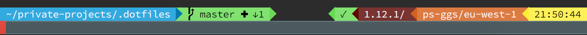
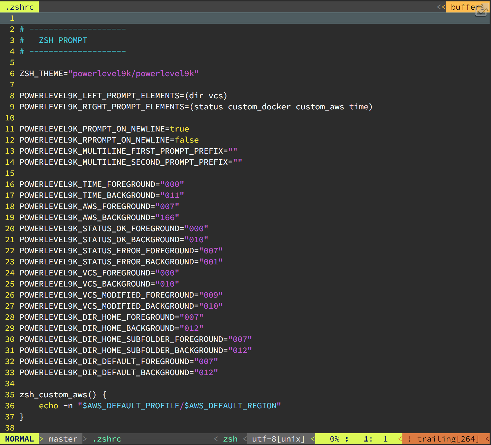

# Konstantins .dotfiles

## Installation

Clone the repository and run the installer:

```zsh
git clone https://github.com/konstantinj/.dotfiles.git ~/.dotfiles
cd ~/.dotfiles
./install.sh
exec zsh
```

The installer is idempotent: existing Git checkouts are reused and already
correct symlinks are left untouched. Existing non-symlink dotfiles are backed
up before linking.

To update the managed dependencies as well, run:

```zsh
UPDATE_DOTFILES_DEPS=1 ./install.sh
```

Machine-specific values and secrets belong in `~/.zshrc.local`. The installer
creates that file once and never overwrites it. For example:

```zsh
export PULUMI_CONFIG_PASSPHRASE='your-local-value'
```

## What's included?

Currently I've only included my .zshrc and my .vimrc.
When running install.sh your current files will be backed up and links to the files in this repo will be created.

## Screenshots




### .zshrc

Of course I'm using [oh-my-zsh](https://github.com/ohmyzsh/ohmyzsh) so you need to install it.

I'm using the powerlevel10k theme and have added custom sections for docker and aws.
I'm working quite heavily with docker, aws and php. Therefore my .zshrc is optimized for that.

The Docker aliases use the current `docker compose` command. The AWS section
shows the currently used profile.

The old Docker Machine/DVM integration is retained in the shell file for
backwards compatibility, but it is optional and not installed by this script.

### .vimrc

There is too much stuff in the .vimrc. Just take a look what I do.
But you need to install [vundle](https://github.com/VundleVim/Vundle.vim) before you can use it.

## What else?

I'm mainly using osx. Some things are optimized for that but I'm also using the same config on linux.
